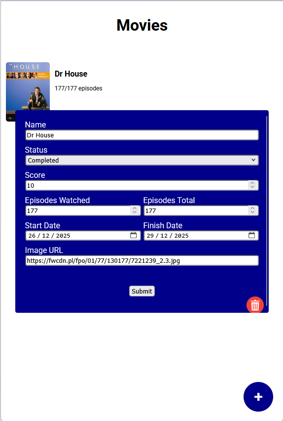

# Watchlist

A personal movies/series tracker built with vanilla JavaScript. Keep a list of what you're watching,
what you've finished and what's next, with your progress and scores saved in the browser.

**Live demo:** [wzolwatchlist.netlify.app](https://wzolwatchlist.netlify.app/)



## Features

- **Add, edit and delete entries**: name, status, score (1–10), episodes watched / total, start and finish dates, cover image
- **Edit in place**: click any entry to open it in the form, pre-filled with its current data
- **Safe deletion**: a confirmation step before an entry is removed
- **Persistent data**: the list is saved to `localStorage`, so it survives page reloads
- **Five statuses**: Watching, Completed, On-Hold, Dropped, Plan to Watch
- **Form closes on outside click**, so you can quickly dismiss it without saving

## Built with

- JavaScript (ES modules, `FormData`, array methods, `localStorage`)
- HTML (form with labelled inputs and built-in validation)
- CSS

## What I learned

This is my first project built from my own idea rather than a course brief. The main challenge
was handling **one form for both adding and editing**: the app tracks which entry is selected,
fills the form with its data, and on submit either creates a new entry or updates the existing
one without mutating the original object.

## Roadmap

- [ ] Tabs to filter the list by status
- [ ] Sorting by score, name or date
- [ ] Dark mode
- [ ] Support for manga alongside anime
- [ ] Simple stats (episodes watched, average score)

## Run locally

No build step needed. Clone the repo and open `index.html` in your browser
(or use the Live Server extension in VS Code).

```bash
git clone https://github.com/wzolnierek/watchlist.git
```
